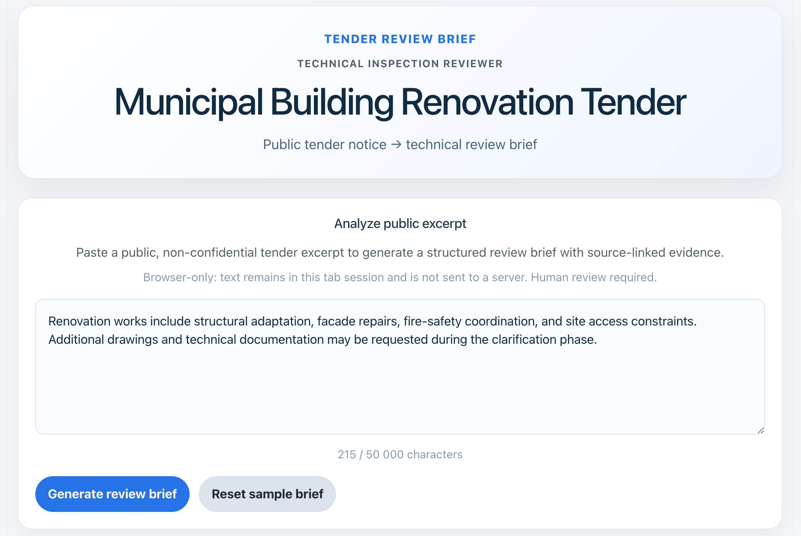
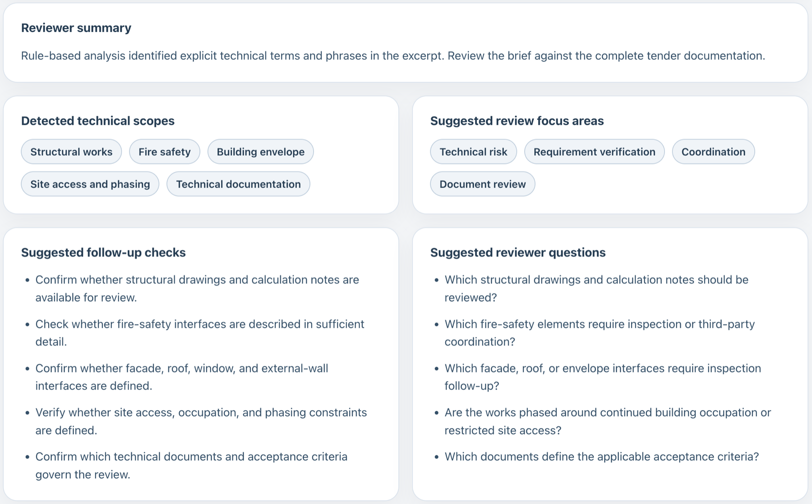
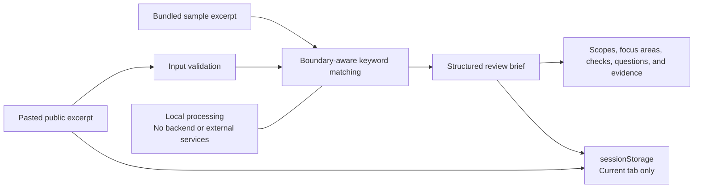

# Tender Review Brief

Tender Review Brief turns public construction tender excerpts into structured, source-linked review briefs.

The application uses an explicit set of boundary-aware keyword rules to identify technical scopes, review focus areas, follow-up checks, reviewer questions, and supporting source passages. It is designed to support, not replace, human technical review.

**Live application:** [Open Tender Review Brief](https://nikolayair.github.io/tender-review-brief/)

**Stack:** React · JavaScript · CSS · Vite · Vitest · Playwright · ESLint

## Interface





## What it does

* Generates a structured review brief from a pasted public tender excerpt.
* Matches explicit English and selected French construction terms using predefined review rules.
* Pairs each matched rule with a supporting source passage, preserving punctuation and internal line breaks.
* Separates detected scopes, review focus areas, follow-up checks, reviewer questions, and evidence.
* Uses boundary-aware matching to reduce false positives from terms embedded inside longer words.
* Produces deterministic results from an explicit, inspectable rule set.
* Processes text locally in the browser without a backend or external service.
* Restores the current excerpt and generated brief after a reload when `sessionStorage` is available.
* Includes a bundled sample excerpt with a brief derived from the same analysis rules.

## Reviewer workflow

1. Paste a public, non-confidential tender excerpt.
2. Generate a structured review brief.
3. Review the detected scopes and suggested focus areas.
4. Check the suggested follow-up checks and reviewer questions against the complete tender documentation.
5. Confirm each finding through human technical review.

The reviewer remains responsible for interpreting the source material and deciding what requires further investigation.

## How it works



## Evidence extraction

For each matched rule, the analyzer selects the first matching term or phrase in source order. When several terms start at the same position, it selects the longest matching phrase.

Newly generated briefs quote the complete source paragraph containing the match. Blank or whitespace-only lines separate paragraphs; ordinary line breaks stay within the paragraph. If a phrase spans paragraphs, all intersected paragraphs are included. This keeps wrapped values, units, lists, negations, and exclusions together with their surrounding paragraph context.

Overlapping passages are combined and stored once. Each passage lists its matched technical scopes in rule order. Evidence preserves source punctuation and internal whitespace, including decimal values such as `1.5 bar`, abbreviations, section references, URLs, tabs, and line breaks. Only leading and trailing whitespace is trimmed.

Supporting passages display ordinary line breaks, tabs, and Unicode line and paragraph separators (U+2028/U+2029). Unicode separators are displayed as line breaks without changing the source text in the generated brief. The input field uses the browser's native textarea rendering, which may display these separators differently.

Passages longer than 1,000 characters are collapsed by default and can be expanded using the keyboard or pointer. Their complete text remains available without truncation. Lengths and input limits use JavaScript's UTF-16 count: an ASCII letter counts as one code unit and `😀` counts as two.

## Current scope

The current rule set covers explicit signals related to structural works, fire safety, accessibility, the building envelope, water and drainage systems, site access and phasing, and technical documentation.

The interface accepts excerpts of up to 50,000 characters. Unit tests cover input validation, matching safeguards, paragraph context, multiline phrases, shared passages, maximum-length input, disclosure markup, bundled-sample consistency, stored-brief validation, and browser-storage fallbacks. Playwright tests in Chromium check visible whitespace, Unicode line breaks, keyboard interaction, disclosure reset, and narrow-screen layout. [Browser checks for source evidence](docs/testing-evidence.md) provide additional manual checks.

## Known limitations

* The analyzer uses keyword rules rather than semantic or contextual language understanding.
* Technical areas outside the current rule set will not be detected.
* French-language support is limited to selected construction terms.
* Evidence follows paragraph boundaries. Conditions in other paragraphs may still be relevant; review the full excerpt and complete tender documentation.
* Keyword matching does not determine whether a mentioned scope is included, excluded, or negated.
* Briefs restored from an older session keep their previous evidence until you generate a new brief.
* The application does not fetch URLs, scrape websites, parse PDFs, or perform OCR.
* Browser storage is best-effort, limited to the current tab session, and may be unavailable under some browser settings.
* The application does not provide document history, authentication, or multi-user workflows.
* The rules have not been validated across a representative collection of tender documents.
* Every generated brief requires human technical review.

## Local development

Install dependencies:

```bash
npm ci
```

Run the development server:

```bash
npm run dev
```

Run the automated checks:

```bash
npm test
npm run lint
npm run build
```

Install Chromium once, then run the browser regressions:

```bash
npx playwright install chromium
npm run test:browser
```

The browser command builds the app and starts a temporary local preview on port 4188. Keep that port available. On Linux, use `npx playwright install --with-deps chromium` when system dependencies are missing. See [Playwright browser installation](https://playwright.dev/docs/browsers) for details.

Run dependency audits:

```bash
npm audit --omit=dev
npm audit
```

## License

No open-source license is currently granted. All rights reserved.

You may view this repository and use GitHub's standard platform features. Copying, redistribution, modification, or reuse beyond those features requires prior permission.
